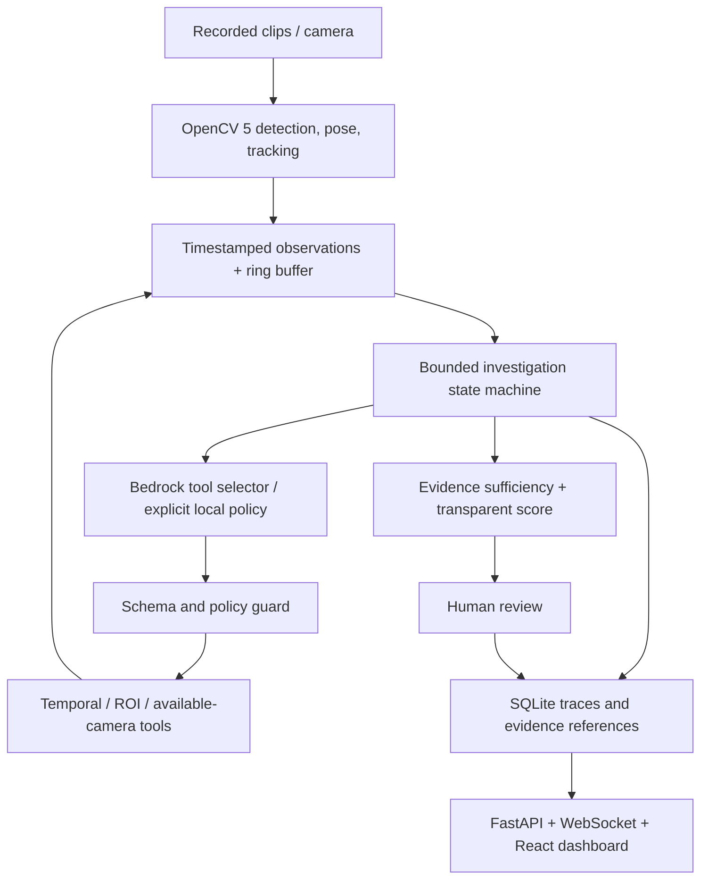

# Technical decision report

Date: 2026-10-25. Historical Phase 0 architecture. For implemented Phase 1 scope
and revised model/tracking choices, see [Phase 1 architecture](phase-1-architecture.md)
and [model selection](model-selection.md). Cloud and LLM components below remain proposed.

## Minimum viable architecture

One Python application with independently testable perception, investigation,
tools and API modules; one React/TypeScript dashboard. A worker thread/process
performs bounded video processing so requests and WebSockets stay responsive.
Use a bounded in-process queue, SQLite incident/trace persistence and local evidence
files. Serve the built UI from the API. Avoid four independently deployed services.

AWS minimum: deploy this working application on a single EC2 instance, with an
instance role, private S3 evidence storage if needed, and CloudWatch logs. This runs
actual investigation on AWS. Bedrock provides bounded tool selection if access is
available. No deployment, bucket, role, paid subscription or public endpoint exists yet.

## Alternatives and decisions

These are engineering judgments, not measured accuracy or cost rankings.

| Choice | Alternatives compared | Proposed decision and reversal condition |
|---|---|---|
| Detector | Zoo MediaPipe person, YOLOX, Ultralytics pose | Start Zoo person+pose via ONNX/OpenCV DNN; compare YOLOX if prone-body recall fails; Ultralytics adds license/dependency considerations |
| Pose | Zoo MediaPipe ONNX, MoveNet/TFLite, YOLO pose | Zoo minimizes runtimes; require actual OpenCV 5 inference and separate model-license check before acceptance |
| Tracking | IoU+Kalman, ByteTrack, BoT-SORT | IoU+Kalman for one fixed view first; ByteTrack if ID switches fail acceptance; BoT-SORT deferred |
| Agent | Custom bounded loop, Strands, LangGraph | Custom loop + Bedrock Converse is smallest auditable surface; frameworks only if state complexity justifies them |
| API | FastAPI, Flask, Django | FastAPI for schemas, async and WebSockets; validate exact dependency resolution in Phase 1 |
| Database | SQLite, PostgreSQL, DynamoDB | SQLite single writer for single-instance demo; migrate if distributed writers required |
| Queue | In-process bounded queue, SQS, Redis | In-process + persisted job state; SQS only after splitting workers across hosts |
| Hosting | EC2, ECS/Fargate, AgentCore | EC2 for same local workload and simplest debugging; ECS for repeatable scaling later; AgentCore optional agent host |
| Frontend | React/Vite, Next.js, plain HTML | React/Vite per requested interaction and no SSR requirement; CSS initially, Lenis/GSAP restrained |

Reference basis: [research](research.md), [landscape](open-source-landscape.md),
[SQLite concurrency](https://www.sqlite.org/isolation.html),
[YOLOX](https://github.com/Megvii-BaseDetection/YOLOX),
[Ultralytics licensing](https://www.ultralytics.com/license).
All models need weight provenance and SHA-256. No model has yet been downloaded.

## State and tools

NORMAL → SUSPECTED → INVESTIGATING → HUMAN_REVIEW → CONFIRMED / DISMISSED.
Only a recorded operator decision creates CONFIRMED. Tool errors transition to
an explicit degraded/insufficient-evidence review path; missing frames never mean
recovery. Escalated means sent for review, not a verified medical event.

Initial tools: analyze_temporal_window, inspect_region, inspect_camera,
generate_evidence_snapshot. Each takes incident ID, track ID, camera ID and bounded
timestamp interval; outputs evidence IDs, source times, quality, observations,
status/error and measured duration. Reject unknown properties, unregistered cameras,
arbitrary paths, stale frames and oversized windows. Limit tool calls and wall time;
deduplicate requests. Tools cannot execute shell commands or contact emergency services.

Policy selects temporal analysis for short observations; inspect_region for poor
visibility; a registered synchronized secondary camera only if available and spatially
associated. Recovery evidence can dismiss the candidate. Missing/ambiguous evidence
causes review with uncertainty, never fabricated multi-view confirmation.

Expose a configurable weighted **evidence score**, not a percentage probability.
Keep score separate from severity and quality. Avoid double-counting correlated
posture/box/pose evidence. Sufficiency requires valid track continuity, visible posture,
temporal coverage and no unresolved quality fault; high score alone is insufficient.
Calibration needs held-out clips and reliability analysis before probability labels.

## Scope and release gates

1. Environment: OpenCV 5 smoke tests, isolated pins, reproducible bootstrap.
2. Vision: real person/pose inference, track continuity and timestamped clips.
3. Investigation: recovery, immobility and unavailable-camera branches run real tools.
4. Product: persisted trace, review actions, accessible dashboard, bounded replay.
5. Cloud: account/region/cost configuration, authenticated deployment and actual trace.
6. Evaluation: paired baseline, fixed-window ablation, active policy; publish failures.
7. Submission: report, demo under five minutes, access checks and repeatable replay.

Skip model training, identity recognition, generalized anomaly classes and elaborate
multi-camera re-identification. COOL is gated separately. Current status completes
research direction and the vision API probe, not the release gates above.
