# Phase 1 implementation

`vision/detection`: replaceable PersonDetector protocol and CPU OpenCV DNN YOLOX.
`vision/tracking`: one-to-one box/velocity association, time-bounded histories.
`vision/motion`: ROI Farneback flow, frame difference and body-height-normalized velocity.
`vision/temporal.py`: upright/descent/horizontal/immobile/recovery state estimation.
`vision/temporal_v2.py`: selected Phase 1B sequence estimator; net descent and posture change.
`vision/diagnostics.py`: actual detections, tracks, motion and decisions at every sampled instant.
`vision/schemas.py`: canonical Pydantic observations, candidates and tool schemas.
`vision/tools.py`: real bounded temporal-window and region-quality analysis.
`vision/evidence.py`: bounded observed-window snapshots and debug overlays.
`vision/source.py`: file replay and process-isolated, bounded webcam reconnection.
`vision/policy.py`: current-evidence disposition; historical recovery cannot dismiss a new event.
`vision/pipeline.py`: source orchestration and structured traces.

```mermaid
flowchart LR
  V[Recorded video] --> D[OpenCV DNN person detection]
  D --> T[Track association]
  T --> M[Geometry + ROI flow]
  M --> S[Temporal state]
  S --> P[Deterministic policy]
  P --> W[Analyze observed window]
  W --> R[Inspect ROI quality]
  R --> E[Candidate / human review / dismissal]
  E --> J[Local evidence + trace + debug AVI]
```

All views are transformations of the same camera, not independent camera evidence.
Fallback rotation is logged in each Detection. Detection confidence and incident
evidence strength are different values. Human review is a request, never automatic
confirmation. The policy is deterministic and explicitly not an LLM agent.

The local viewer uses OpenCV overlays, not a frontend. It labels track, state, score,
stationary duration and requested action. Video timestamps are derived from recorded
frame index/FPS; variable-frame-rate accuracy is not established. Evidence manifests
preserve sampled times. Flow uses a fixed spatial ROI across the two frames.

Limits: at most 600 seconds/run, 30 sampled FPS, 100 incident packets, ten seconds
of tool history (300 observations across all tracks), and bounded frame dimensions.
Defaults are much smaller. Evidence is rewritten on action/status changes, not stored
as an unlimited source recording. Debug AVI is bounded by run duration. Total storage
across repeated runs requires manual cleanup.

Tool validation errors raise explicit exceptions; valid insufficient inputs return
structured `insufficient_evidence`. Invalid source files fail with a clear exception.
Premature decode end is recorded separately from EOF. No recovery is inferred from
missing detections. Hardware inference calls are bounded in input size and pass count,
but do not have a process-isolated wall-clock cancellation deadline yet.

The reusable tool contract for Phase 2 must add authenticated camera binding,
per-investigation authorization, cancellation/timeouts and durable audit persistence.
The current in-process APIs are not exposed to arbitrary network callers.

Webcam capture is opt-in through `--camera INDEX`. Native open/read calls run in a
spawned process, with a two-frame queue, two-second receive timeout and two reconnect
attempts per run. A failed capture process is terminated before restart. Reconnection
clears tracking, temporal state, tool history and buffered evidence; track IDs continue
increasing and capture timestamps use a monotonic clock. No missing frame is replayed
as new evidence. Four source tests cover file timestamps/EOF, bounded reconnect,
fresh frames after reconnect and termination of a stalled worker. These use controlled
transport fixtures, not a physical camera; actual webcam unplug/replug remains untested.
Capture-process cancellation does not provide cancellation for DNN or evidence tools.

## Phase 1B selected configuration

`Config()` and the CLI select tracking + temporal improvements (variant D). CLI and
evaluation `--variant baseline` retain the original behavior for ablations. Gap retention
is separate from motion continuity: identities may survive 1.5 seconds without a
detection, but no missing box is emitted and no gap contributes stationary time.
Velocity prediction is capped at 0.25 seconds; association gates area changes and
refuses ambiguous reattachment. Raw measured boxes are retained rather than smoothed
through a fall. This is not a full appearance-based tracker and crossing identities
remain unvalidated.

The new sequence estimator requires net center descent, downward speed, observed
upright history, height loss and horizontal geometry within a bounded window. The
initial compact-low alternative was removed after it confused squatting/sitting
with falls. Horizontal geometry alone cannot create an event. The estimator tolerates
unobserved intermediate states but records the observation gap and reference time.
`fall_event_detected` marks a new transition independently of `stationary_duration`;
`ground_observed` is a low-posture geometry proxy, not a calibrated ground plane.
`decision_reason` and `transition_signals` expose the evidence behind each decision.
Recovery requires upward motion and upright geometry and clears old reference history.

Optional low-score continuation (variant E) uses a 0.15 detection floor with 0.30
initialization threshold. Association prioritizes strong detections and requires
tighter overlap/distance for weak ones. Weak detections cannot establish stationary
evidence. This remains opt-in and is rejected as the default after visual inspection
showed an oversized box at the apparently earlier alert. No additional model or
dependency was installed.
